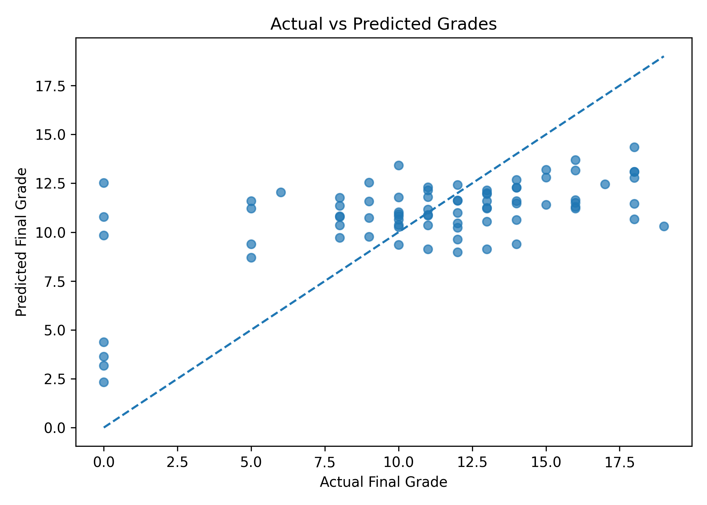
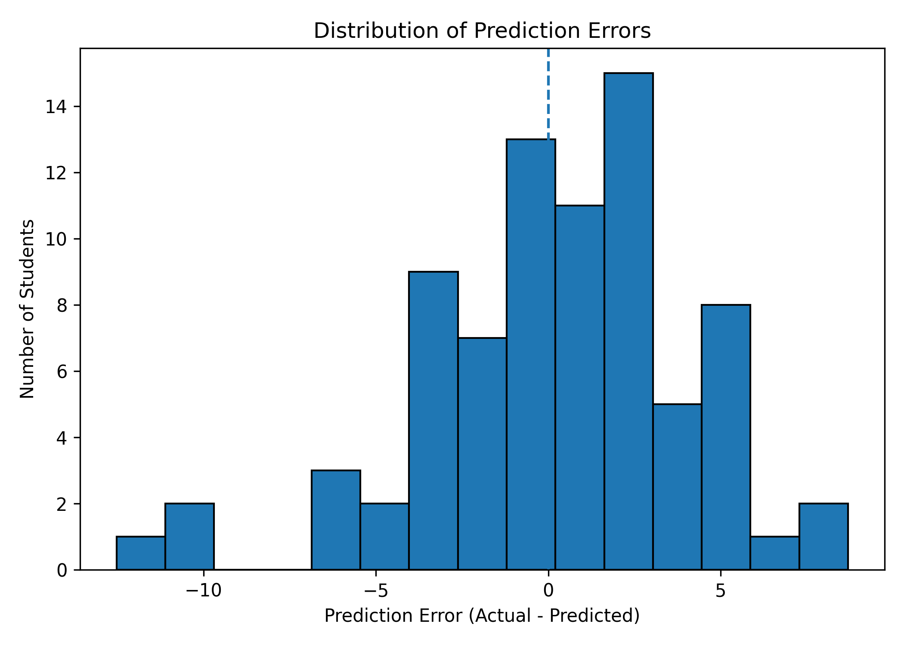
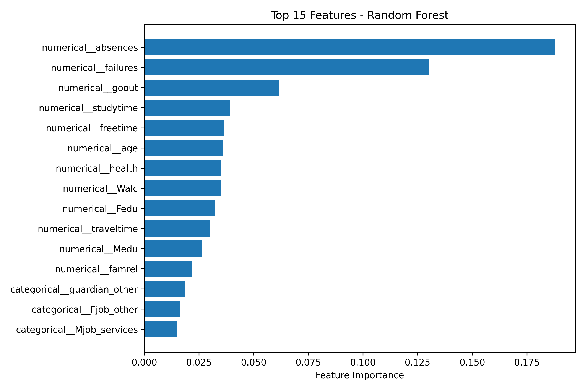

# Student Performance Prediction

A machine learning project that predicts students' final mathematics grades
using demographic, family, school, and lifestyle features.

## Project Objective

The goal is to explore student data, train regression models, compare their
performance, and analyze prediction errors and feature importance.

## Dataset

- Source: [UCI Student Performance Dataset](https://archive.ics.uci.edu/dataset/320/student+performance)
- File: `student-mat.csv`
- Samples: 395
- Original columns: 33
- Input features used: 30
- Target: `G3`, the final mathematics grade

The earlier grades `G1` and `G2` are excluded from the input features to avoid
relying directly on previous grades when predicting the final grade.

## Workflow

1. Download and load the dataset.
2. Explore columns, missing values, duplicates, and grade distributions.
3. Separate input features and target.
4. Split the data into training and testing sets.
5. Encode categorical features using One-Hot Encoding.
6. Train and compare regression models.
7. Evaluate models using MAE, RMSE, and R-squared.
8. Use five-fold cross-validation on the training set.
9. Analyze prediction errors and feature importance.

## Models

- Mean Baseline
- Linear Regression
- Random Forest Regressor

The Random Forest model uses 300 trees, a minimum leaf size of 2,
and a fixed random seed for reproducibility.

## Final Test Results

The following results are from the held-out test split.

| Model | MAE | RMSE | R-squared |
|---|---:|---:|---:|
| Mean Baseline | 3.754 | 4.821 | -0.026 |
| Linear Regression | 3.406 | 4.203 | 0.220 |
| Random Forest | 2.971 | 3.855 | 0.344 |

Lower MAE and RMSE are better. Higher R-squared is generally better.

## Five-Fold Cross-Validation

Cross-validation results on the training set:

| Model | Mean MAE | Mean RMSE | Mean R-squared |
|---|---:|---:|---:|
| Mean Baseline | 3.361 | 4.519 | -0.009 |
| Linear Regression | 3.405 | 4.415 | 0.036 |
| Random Forest | 2.943 | 3.887 | 0.253 |

## Feature Importance

The five highest-ranked features in the fitted Random Forest model are:

- `absences`: 0.1877
- `failures`: 0.1301
- `goout`: 0.0614
- `studytime`: 0.0392
- `freetime`: 0.0367

Feature importance indicates how the model uses features. It does not
establish causal relationships.

## Visual Results

### Actual vs. Predicted Grades

### Prediction Errors

### Feature Importance

## How to Run

1. Install the required libraries:

   `pip install -r requirements.txt`

2. Open `student_performance_prediction.ipynb` in Google Colab or Jupyter.
3. Run the notebook cells from top to bottom.

The notebook downloads the dataset from UCI, so an internet connection
is required.

## Limitations

- The dataset contains only 395 students from two Portuguese schools.
- The project focuses on mathematics grades and may not generalize to other
  subjects, schools, or populations.
- Predictions have noticeable errors, especially for some very low and high
  grades.
- Feature importance does not imply causation.
- This model is an educational project, not a tool for making decisions
  about individual students.

## Tools

Python, Pandas, NumPy, Matplotlib, Scikit-learn, and Requests.

## Dataset Reference

Cortez, P., & Silva, A. M. G. (2008).
Using data mining to predict secondary school student performance.
